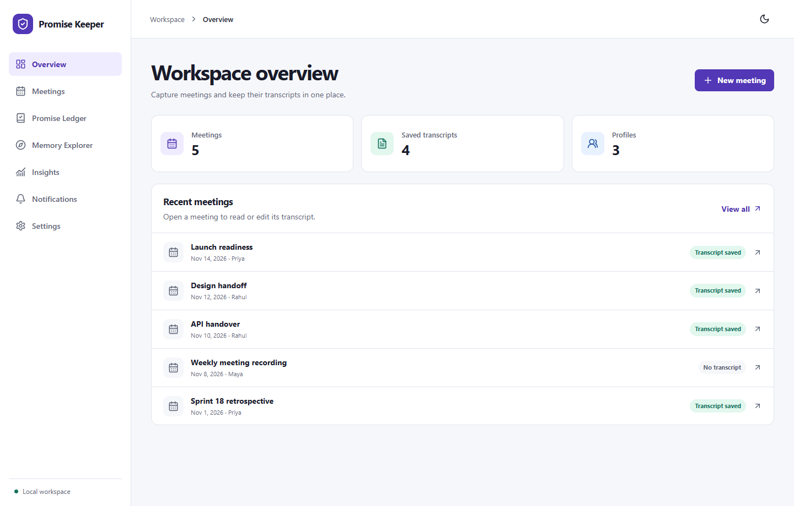
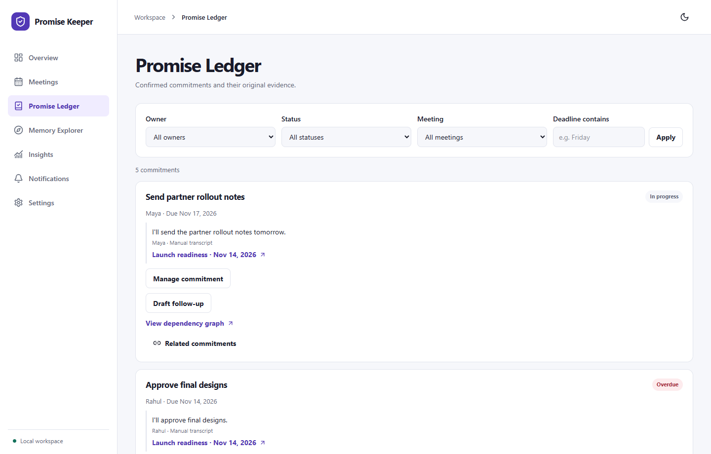
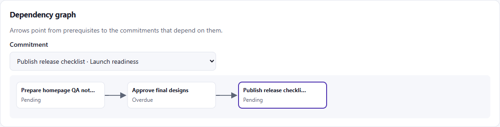
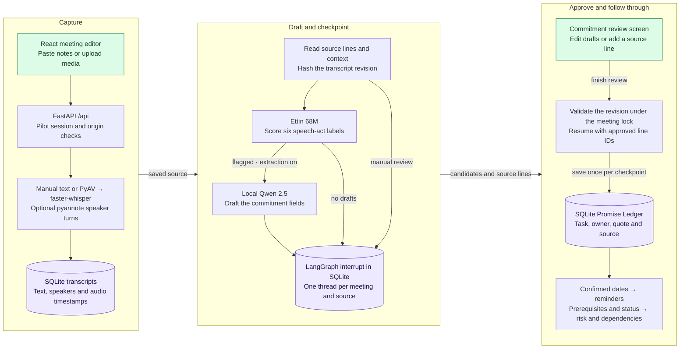
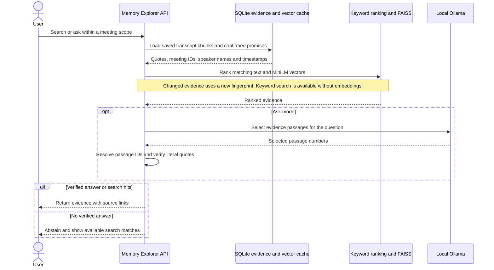

# Promise Keeper

Promise Keeper turns a meeting recording into a ledger of commitments. Each entry keeps the task, owner, and deadline alongside the original quote and, for audio, its timestamp. When someone asks why an item is overdue or what was agreed in a previous meeting, the workspace can point back to the evidence.

[Product demo](#product-demo) · [Architecture](#architecture) · [Run locally](#run-locally) · [Results](#results)

## Product demo

The screenshots show a local workspace populated with fictional launch-planning meetings.



1. **Capture.** Create a profile and a meeting, then paste a transcript or upload an MP3, WAV, M4A, or MP4. Edit the transcript and speaker names while keeping the audio timestamps.
2. **Review.** Choose the transcript source and run analysis. Check each draft against the quote, correct the details, and approve the entries you want in the ledger. Use **Add a missed commitment** for a line the detector skipped or **Review transcript manually** to work without the classifier.
3. **Follow through.** Confirm an actual calendar date to activate reminders. Link prerequisites and attach evidence when completing a commitment. Use Memory Explorer to find and open a quote from a past meeting.



The dependency graph points from prerequisite to dependent. In this demo, the team needs the QA notes before approving the designs, and the designs need approval before the release checklist can be published.



<details>
<summary>Transcript to paste for a quick demo</summary>

```text
Rahul: The API gateway caches product results for thirty seconds.
Priya: I'll send the launch checklist to Rahul by Friday.
Maya: We should improve the deployment checklist.
Rahul: Could you review the monitoring dashboard?
```

Save this under **Manual transcript**. Approve Priya's promise and ask Memory Explorer, “What did Rahul say about the API?” Open the cited meeting to verify the answer.

</details>

## Architecture

React and TypeScript run in the browser. FastAPI serves the API and the production build on one origin in pilot mode. The pilot uses one password-protected workspace. Its database and default inference services run locally.

### From transcript to approved promise



Analysis locks one meeting at a time, so another meeting can still finish. A source edit changes the review revision. A stale approval is rejected, and retrying a completed save does not duplicate the promise. The original deadline wording stays attached to the quote. Scheduled alerts use the calendar date a user confirms.

### How Memory Explorer checks an answer



## Run locally

Use Python 3.11 or newer, Node.js 22.12 or newer, and PowerShell. From the repository root:

```powershell
cd backend
python -m venv .venv
.\.venv\Scripts\python.exe -m pip install -r requirements.txt -r requirements-audio.txt -r requirements-memory.txt "transformers>=4.51,<5"
cd ../frontend
npm.cmd ci
npm.cmd run build
cd ../backend
.\run-pilot.ps1
```

Set a workspace password at the prompt and open [the local pilot](http://127.0.0.1:8000). The manual transcript and review path works without model downloads. For frontend development, run Uvicorn from `backend` on port 8000 and `npm.cmd run dev` from `frontend`, then open [Vite](http://localhost:5173).

| Capability | Local setup |
| --- | --- |
| Speech to text | faster-whisper downloads the `small` model on first use. Set `PROMISE_KEEPER_WHISPER_MODEL` to choose another model or a local directory. Recordings can be up to 100 MiB and 60 minutes. |
| Commitment detection | Put a trained Ettin export in `backend/data/phase3/classifier/` or set `PROMISE_KEEPER_CLASSIFIER` to the export directory. See [training](#training-and-evaluation). |
| Field drafts, answers, and briefings | Install and start Ollama, then run `ollama pull qwen2.5:1.5b`. The API defaults to `http://127.0.0.1:11434`. [Ollama setup](https://docs.ollama.com/windows) |
| Semantic retrieval | Run the MiniLM download below from `backend`. Keyword retrieval is available while setting up the model. |
| Speaker detection | Install `requirements-speakers.txt` and follow the model setup if you want automatic speaker turns. [pyannote Community-1](https://huggingface.co/pyannote/speaker-diarization-community-1) |

```powershell
.\.venv\Scripts\python.exe -c "from huggingface_hub import snapshot_download; snapshot_download('sentence-transformers/all-MiniLM-L6-v2', revision='1110a243fdf4706b3f48f1d95db1a4f5529b4d41', local_dir='data/models/all-MiniLM-L6-v2', allow_patterns=['*.json','vocab.txt','model.safetensors','1_Pooling/config.json'])"
```

SQLite defaults to `backend/data/promise_keeper.db`. Set `PROMISE_KEEPER_DB_PATH` to use a separate database. Run `.\.venv\Scripts\python.exe backup_workspace.py data/pilot-backup.sqlite3` from `backend` for an integrity-checked backup with sessions removed. [Caddy configuration](Caddyfile) is available for an optional shared-workspace HTTPS pilot.

## Results

| Check | Observed result |
| --- | --- |
| Application | 29 backend tests passed. The production frontend build and Chrome review-to-ledger flow passed, including manual recovery after a classifier failure. |
| Audio upload | One MP4 produced 23 timestamped segments. Speaker edits preserved the timestamps. |
| Local field extraction | A known transcript example returned the expected task, owner, recipient, and deadline through Ollama. |
| Memory Explorer | The expected citation appeared for 8 of 8 supported questions. The system abstained on all 3 unsupported questions in the same local benchmark. |

Two public standups were evaluated using selected timestamped reference commitments and the frozen `icsi-recall` export.

| Recording | Reference commitments routed | Transcript segments sent to review |
| --- | ---: | ---: |
| [Fiber Squad standup](https://youtu.be/T8GcCl8w-_E) | 1 / 1 | 10 / 77 |
| [Software standup roleplay](https://youtu.be/MsxcpZr1LpM) | 6 / 7 | 45 / 93 |
| **Total** | **7 / 8** | **55 / 170** |

The first recording used the English transcription setting. One other supplied event was unresolved and left outside the scored references. The second recording missed the plan to discuss the data export request. These references cover selected events. Full independent labels are still needed to measure precision and how often the extracted fields are correct. [Timestamped reference manifest](backend/evaluation/phase8-standups.json)

## Training and evaluation

The detector fine-tunes Ettin 68M with LoRA and selects a routing threshold on validation data before testing. Training inputs include AMI meeting sentences and the Parakweet Email Intent Dataset. ICSI meeting turns and Hansard examples were used in additional development and challenge sets. [AMI sentence splits](https://huggingface.co/datasets/Jvachier/meeting-notes-extractive-v1/tree/v1.1/data/ami/sentences) · [Parakweet data](https://github.com/ParakweetLabs/EmailIntentDataSet/tree/master/src/resources) · [ICSI via MRDA](https://github.com/NathanDuran/MRDA-Corpus) · [Hansard licence](https://www.parliament.uk/site-information/copyright/open-parliament-licence/)

From `backend`, place `ami-train.parquet`, `ami-validation.parquet`, `ami-test.parquet`, `Ask0729-fixed.txt`, and `testSet-qualifiedBatch-fixed.txt` in `data/phase3/`. Then build and review the annotation queue.

```powershell
.\.venv\Scripts\python.exe -m pip install -r requirements-training.txt
.\.venv\Scripts\python.exe prepare_commitments.py
.\.venv\Scripts\python.exe review_commitment_labels.py
.\.venv\Scripts\python.exe train_commitments.py data/phase3/reviewed-labels.jsonl
.\.venv\Scripts\python.exe -m unittest discover -v
```

For the standup check, put the recordings in `backend/data/phase8/recordings/` with the video IDs as filenames. With the classifier ready and Ollama running, use the commands below from `backend`.

```powershell
.\.venv\Scripts\python.exe evaluate_standups.py --english-first --extract --output data/phase8/standup-evaluation-english.json
.\.venv\Scripts\python.exe evaluate_standups.py --review-queue data/phase8/full-standups-review-queue.jsonl
.\.venv\Scripts\python.exe review_commitment_labels.py --queue data/phase8/full-standups-review-queue.jsonl --output data/phase8/full-standups-reviewed.jsonl
```

Have a reviewer label every segment before showing predictions. Use [evaluate_commitments.py](backend/evaluate_commitments.py) with the original queue, completed labels, frozen export, and the actual training and calibration inputs. The evaluator checks completeness and overlap, prints precision and recall, and saves the metrics chart.

## Code map

| Where | Responsibility |
| --- | --- |
| [frontend/src](frontend/src) | React screens, transcript editor, and typed API client |
| [audio.py](backend/app/audio.py) · [audio_routes.py](backend/app/audio_routes.py) | Decode recordings, transcribe, and preserve timestamps through edits |
| [commitment_graph.py](backend/app/commitment_graph.py) · [commitment_routes.py](backend/app/commitment_routes.py) | Classify lines, draft fields, pause, and validate approvals |
| [ledger.py](backend/app/ledger.py) · [lifecycle_routes.py](backend/app/lifecycle_routes.py) | Write approved evidence and track promise status, deadlines, and prerequisites |
| [memory.py](backend/app/memory.py) · [memory_routes.py](backend/app/memory_routes.py) | Retrieve source passages and validate answer citations |
| [notifications.py](backend/app/notifications.py) · [insights.py](backend/app/insights.py) | In-app reminders, deadline and dependency risk, and meeting history |

The pilot stores transcripts and confirmed promises on the host machine and processes uploads temporarily. Git contains the application, test code, and demo screenshots. Recordings, workspace databases, credentials, and model weights stay local.
